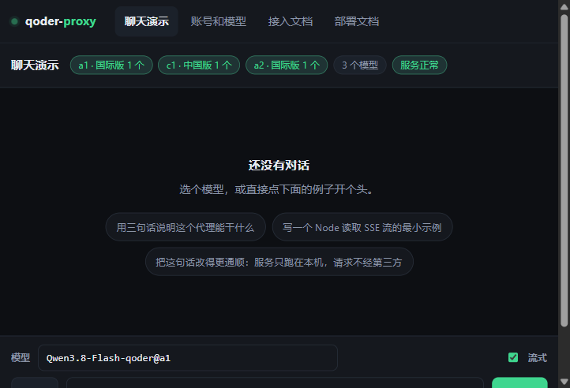
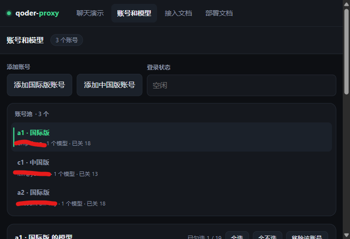
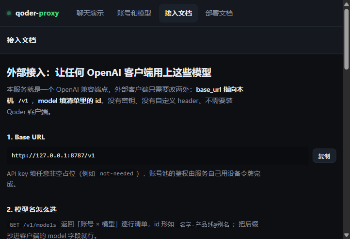
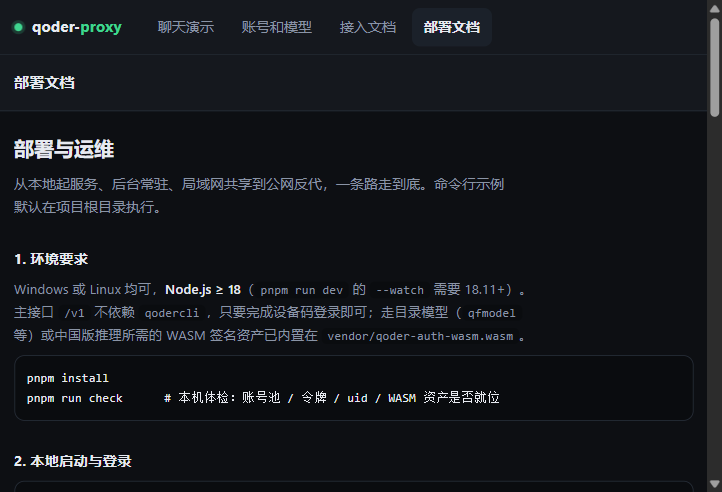

# qoder-proxy

> 为什么要做这个项目？因为 Qoder 的免费模型真香！是真免费！

把 Qoder / Qoder CN 账号里的对话模型抽象成一整套 **OpenAI 兼容的 HTTP API**，供本地任意程序、任意 AI Agent 直接调用，**支持多账号池**：

- 账号池同时挂多个登录，国际版与中国版可以混着登，令牌自动续期、限流排队自动换号，调用方不需要感知后面有几个账号；
- 登录、签名、加密通道、流式拆解等细节全部封装在服务里，接入方只需要一个 `base_url` 和一个模型名。

## Agent端如何接入


```bash
curl http://127.0.0.1:8787/v1/chat/completions \
  -H "Content-Type: application/json" \
  -d '{
    "model": "Qwen3.8-Flash-qoder@a1",
    "stream": true,
    "messages": [{"role": "user", "content": "你好"}]
  }'
```

```python
from openai import OpenAI

client = OpenAI(base_url="http://127.0.0.1:8787/v1", api_key="not-needed")
resp = client.chat.completions.create(
    model="Qwen3.8-Flash-qoder@a1",
    messages=[{"role": "user", "content": "你好"}],
)
print(resp.choices[0].message.content)
```

```javascript
import OpenAI from "openai";

const client = new OpenAI({ baseURL: "http://127.0.0.1:8787/v1", apiKey: "not-needed" });
const resp = await client.chat.completions.create({
  model: "Qwen3.8-Flash-qoder@a1",
  messages: [{ role: "user", content: "你好" }],
});
console.log(resp.choices[0].message.content);
```

OpenAI 兼容客户端（LobeChat / ChatWise / Open WebUI / Jan 等）与各类 Agent 只需要配这几项：

| 配置项 | 填什么 |
|---|---|
| Base URL / API 端点 | `http://127.0.0.1:8787/v1`（局域网或反代后换成对应地址） |
| API Key | 任意非空占位串 |
| 模型 id | 直接抄 `GET /v1/models` 返回的 id，形如 `Qwen3.8-Flash-qoder@a1` |


## 前置条件

运行环境：Windows 与 Ubuntu/Linux 均可（Node.js ≥ 18）。

服务只需独立完成设备码登录（见下文），登录一次即可长期调用。要走目录模型（`qfmodel` 等）或中国版推理，需要 `vendor/qoder-auth-wasm.wasm` 签名资产就位（本仓库已内置）。

## 安装与启动

```bash
pnpm install
pnpm login          # 登录qoder/qoder cn账号
pnpm start          # 启完后浏览器打开 http://127.0.0.1:8787/ 就是演示聊天台
pnpm run dev        # 开发模式：走 8788，改代码自动重启（scripts/dev.js + node --watch）
pnpm run clear      # 清掉账号池里存的所有令牌（要输 clear 确认）
```


默认监听 `http://127.0.0.1:8787`：


## 演示页面（GET /）

服务起来后直接用浏览器打开 `http://127.0.0.1:8787/` 就是一个控制台，左侧导航四个页面：聊天演示、账号和模型、接入文档、部署文档。

| 聊天演示 | 账号和模型 |
|---|---|
|  |  |

| 接入文档 | 部署文档 |
|---|---|
|  |  |


## 多账号登录与模型命名

**登录次数不限，两个产品线可以混着登。** 不带参数时是一个键盘菜单（↑/↓ 移动、回车确认选中那行、Ctrl+C 或 q 退出），每次只登一条线，每条线后面直接列出已登了几个、别名是什么：

```
选择要登录的产品线（当前账号池：a1）

❯ Qoder          已登录 1 个：a1(Chip Tong)
  Qoder (中国版)  尚未登录
↑/↓ 选择，回车 确认，Ctrl+C 退出
```

一次只登一条产品线；要登另一条，跑完这一次再跑一次就是（两道授权互不干扰，不会因先登国际版而卡住）。命令行方式全保留：

```bash
pnpm run login                       
```


**同一可以清理令牌**：

```bash
pnpm run clear                
```


## 接口说明

对外只有下面三个路由：账号与模型的勾选统一在命令行和演示页里维护，调用方只消费模型目录与对话接口。

### GET /v1/models

就是「账号 × 模型」的逐行清单：每条 id 形如 `Qwen3.8-Flash-qoder@a1`，一个模型在一个账号上只出现一次，没有裸名条目（国际版账号会多出通用名）。条目附带 `model_key`（Qoder 短名，同样可以作为 `model` 传入）、`display_name`、`account_nickname`、`product`、`context_window`、`free`、`price_factor`、`efforts` 等目录信息，可直接喂给选择界面。被在「账号和模型」页取消勾选的条目不会出现在这里，也不接受请求。

### POST /v1/chat/completions

OpenAI 兼容。`model` 同时决定账号与上游路由：目录模型写真实名或短名都行，可带产品线与账号后缀；通用名只有国际版可用。代理在发上游前把真实名换成目录短名，不会把显示名泄给 Qoder。

行为要点：

- `stream:true` 得到标准 SSE，且无论上游是否正常收尾，流一定以 `data: [DONE]` 结束（上游吞掉终止帧或中途中断时由本服务补齐，客户端不会挂在半开连接上）；`stream` 省略时由本服务把流式帧聚合回一条 `chat.completion`（含 `tool_calls` 增量合并与 `usage`）；
- 上游业务错误帧的 `code` 字段与 `message` 原文**保真转发**，排队/额度判断不会被降级成普通 500；心跳帧丢弃，避免 `data: null` 打挂下游；
- `tools` / `tool_calls` / `tool_call_id` 完整透传（丢掉其中任一个，模型就会改用正文 XML 臆造调用）；`reasoning_effort` 仅当目录允许关闭时才映射为 `none`；`temperature`/`top_p` 这类采样参数上游不支持，不透传；
- access token 过期自动续期，401 强制续期重试一次，续期按账号去重，并发请求不会把 refresh_token 打爆。

### GET /health

健康检查，返回服务状态与账号池概况。
